<p align="center">
  
</p>

<div align="center">

# ⚪ KHRESMUPU ⚪

### **Khresna Mulia Putra**

`CREATIVE DEVELOPER` · `WEB DEVELOPER` · `3D WEB INTEGRATOR` · `DIGITAL MUSIC PRODUCER`

<br>


<br>


<br><br>

<a href="https://portofolio-khresmupu.netlify.app/">

</a>

<a href="https://github.com/khresmupu33">

</a>

<a href="mailto:khresmupu@gmail.com">

</a>

<br><br>

`━━━━━━━━━━━━━━━━━━━━━━━━━━━━━━━━━━━━━━━━━━━━━━━━━━━━`

</div>

---

# ⚪ `> WHOAMI`

<div align="center">



</div>

<br>

> **Creative Developer** yang menggabungkan teknologi, desain visual, 3D, dan musik untuk membangun pengalaman digital yang interaktif.

Saya adalah mahasiswa **Universitas Kristen Maranatha** yang memiliki ketertarikan pada pengembangan website, integrasi animasi 3D, UI/UX, dan produksi musik digital.

Saya percaya bahwa sebuah website tidak hanya harus **berfungsi**, tetapi juga harus mampu **menyampaikan pengalaman dan cerita**.

---

# ⚪ `> CURRENT_FOCUS`

```text
╭────────────────────────────────────────────────╮
│                                                │
│  ▰  WEB DEVELOPMENT                           │
│  ▰  FRONT-END DEVELOPMENT                     │
│  ▰  UI / UX DESIGN                            │
│  ▰  3D WEB INTEGRATION                        │
│  ▰  BLENDER 3D                                │
│  ▰  PHP & SQL                                 │
│  ▰  DIGITAL MUSIC PRODUCTION                  │
│  ▰  CREATIVE TECHNOLOGY                       │
│                                                │
╰────────────────────────────────────────────────╯
```

---

# ⚪ `> TECH_STACK`

<div align="center">

## WEB DEVELOPMENT


<br><br>

## DESIGN & 3D


<br><br>

## TOOLS & DEVELOPMENT


</div>

---

# ⚪ `> SKILL_MATRIX`

| Skill | Level | Focus |
| :--- | :---: | :--- |
| Front-End Development | `80%` | HTML · CSS · JavaScript · Responsive Design |
| UI / UX Design | `80%` | Interface · Layout · User Experience |
| Blender & 3D Web | `75%` | Modeling · Animation · Web Integration |
| Problem Solving | `70%` | Logic · System Flow · Optimization |
| Music Production | `65%` | Instrumental · Soundscape · Storytelling |
| PHP & SQL | `50%` | Backend · Database · CRUD |

<br>

```text
FRONTEND          ████████████████░░░░  80%
UI / UX           ████████████████░░░░  80%
BLENDER / 3D      ███████████████░░░░░  75%
PROBLEM SOLVING   ██████████████░░░░░░  70%
MUSIC PRODUCTION  █████████████░░░░░░░  65%
PHP / SQL         ██████████░░░░░░░░░░  50%
```

---

# ⚪ `> EXPLORE_MY_PROFILES`

<div align="center">

| Platform | Purpose |
| :--- | :--- |
| Portfolio | Web development & creative projects |
| Music | Original instrumental compositions |
| SwimCloud | Swimming achievements |
| Chess.com | Chess activity |
| Olimpiadeku | Competition & achievement records |
| Academia | Research & academic documentation |

</div>

---

# ⚪ `> CURRENTLY_BUILDING`

<div align="center">

```text
╭────────────────────────────────────────────────╮
│                                                │
│  ▰  WEB APPLICATIONS                          │
│                                                │
│  ▰  INTERACTIVE DIGITAL EXPERIENCES            │
│                                                │
│  ▰  3D WEB LEARNING MEDIA                     │
│                                                │
│  ▰  FINANCIAL TECHNOLOGY FOR UMKM              │
│                                                │
│  ▰  ORIGINAL INSTRUMENTAL MUSIC                │
│                                                │
╰────────────────────────────────────────────────╯
```

</div>

---
# ⚪ `> GITHUB_CONTRIBUTIONS`


<div align="center">

</div>


---
# ⚪ `> LET'S_CONNECT`

<div align="center">

### **Interested in web development, creative technology, 3D web, or digital projects?**

**Let's build something meaningful.**

<br>

<a href="https://portofolio-khresmupu.netlify.app/">

</a>

<a href="mailto:khresmupu@gmail.com">

</a>

<a href="https://github.com/khresmupu33">

</a>

<br><br>

`SYSTEM STATUS: ONLINE`

`CREATIVITY: ACTIVE`

`BUILDING: CONTINUOUS`

<br>

**© 2026 KHRESMUPU**

</div>

<p align="center">
  
</p>
